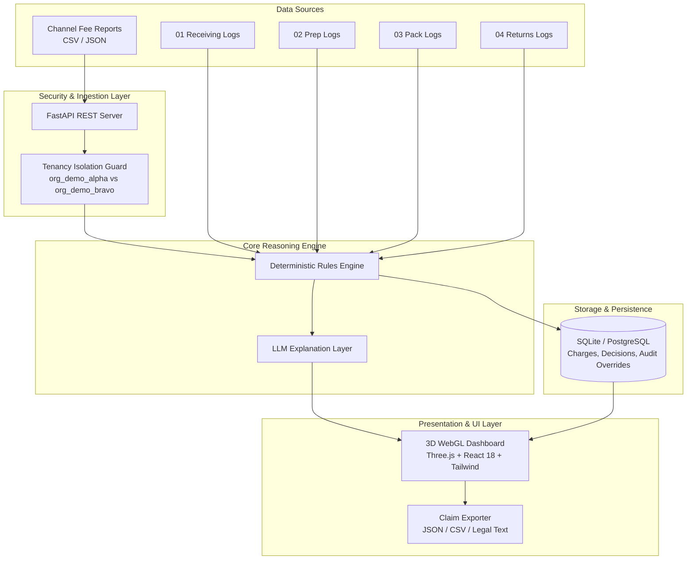
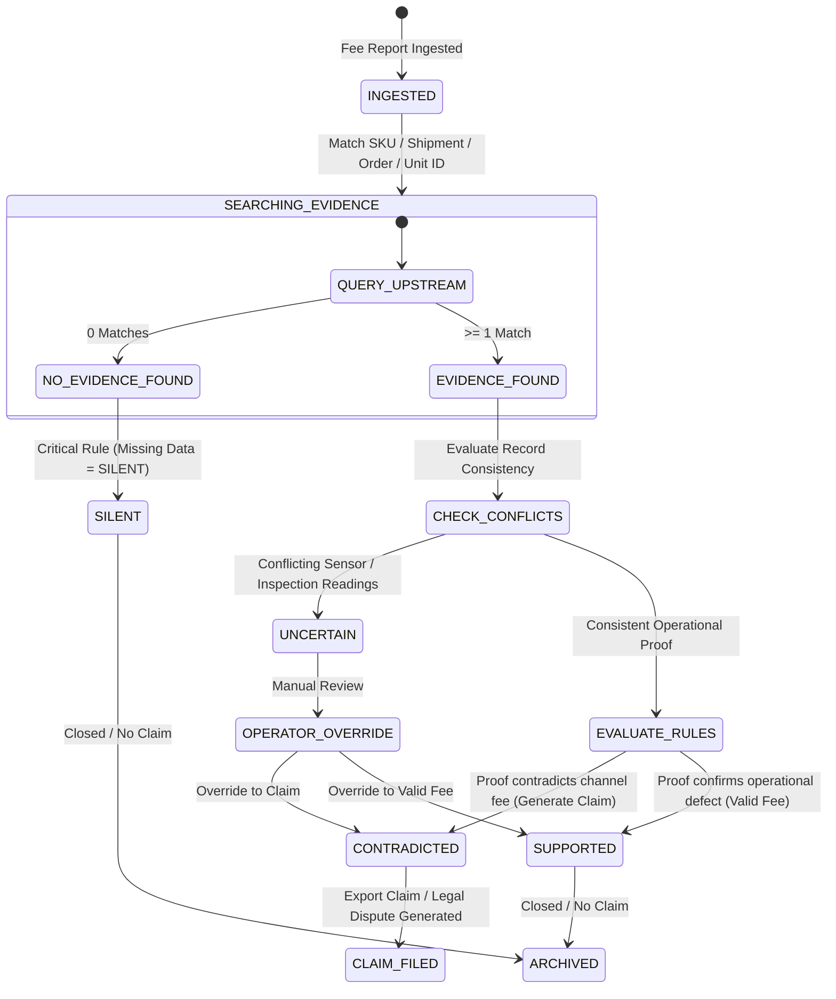
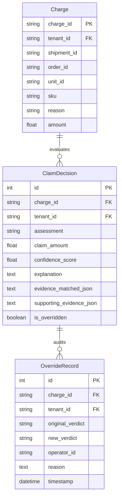

# Architecture Specification · AI Recovery Manager

**Commerce Context Stream · Step 5 of 5 · Money Back**

---

## 1. High-Level System Architecture

AI Recovery Manager is architected as a decoupled, multi-tenant recovery engine designed to bridge channel fee reports (Amazon FBA, Walmart WFS, 3PLs) with physical operational evidence produced across four upstream warehouse managers:

1. `01 Receiving Manager` (Condition on arrival, box damage, seal verification)
2. `02 Prep Manager` (Poly-bagging, suffocation warning labels, bubble wrap, FNSKU scanning)
3. `03 Pack Manager` (Weight sensors, dimensions, box seal integrity)
4. `04 Returns Manager` (Customer return inspection, disposition, carrier damage classification)

---

## 2. Charge Assessment State Machine

Every charge follows a strict, deterministic state progression. The system is conservative and defensible: **it never invents evidence**, missing data yields `SILENT`, and ambiguous data yields `UNCERTAIN`.

---

## 3. Data Models & Database Schema

The database schema enforces tenancy isolation, auditing, and complete traceability.

---

## 4. Multi-Tenant Isolation Model (Engineering Rule 1)

Tenancy isolation is enforced before any feature evaluation.
- Every incoming HTTP request must specify `X-Tenant-ID` header or query parameter `tenant_id_query`.
- Allowed tenants: `org_demo_alpha`, `org_demo_bravo`.
- Data isolation is enforced at:
  1. Database queries (`WHERE tenant_id = :tenant`).
  2. In-memory evidence log filtering via `src/core/tenant_security.py`.
  3. Strict cross-tenant security assertions (`assert_tenant_isolation`).

---

## 5. Overrides as Data Architecture (Engineering Rule 6)

When an operator disagrees with the agent verdict:
1. The original verdict in `ClaimDecision` is recorded.
2. An append-only audit record is inserted into `OverrideRecord` containing:
   - `charge_id`
   - `tenant_id`
   - `original_verdict`
   - `new_verdict`
   - `operator_id`
   - `reason`
   - `timestamp`
3. `is_overridden` flag is set to `true`. Original evidence and history are preserved for complete compliance audits.

---

## 6. REST API Endpoint Specification

| Method | Endpoint | Description |
| :--- | :--- | :--- |
| `GET` | `/health` | System health check. |
| `GET` | `/tenants` | List available tenant organizations. |
| `POST` | `/upload-report` | Ingest CSV or JSON fee report file. |
| `POST` | `/analyze` | Execute reasoning engine for tenant charges. |
| `GET` | `/results` | Fetch analyzed charge results with status filter. |
| `POST` | `/overrides` | Record operator verdict override. |
| `GET` | `/export` | Export claims in JSON or CSV format. |
| `GET` | `/eval` | Run evaluation suite against ground truth fixtures. |

---

*AI Recovery Manager Architecture Specification*
